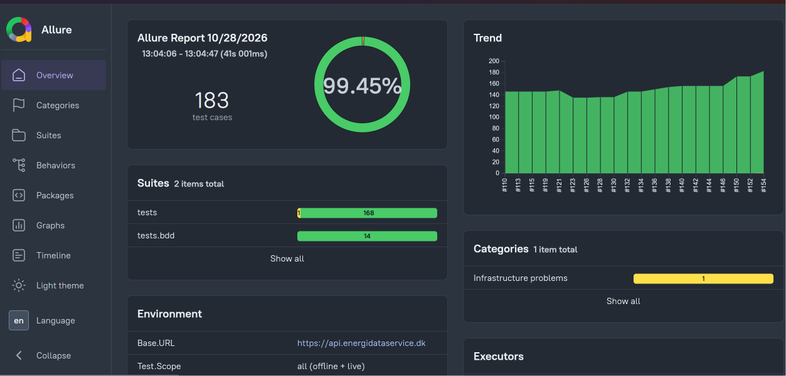
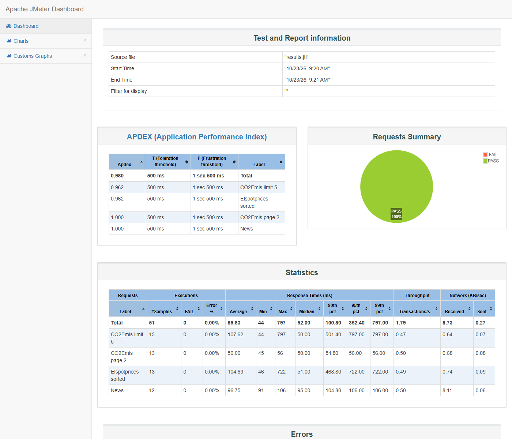
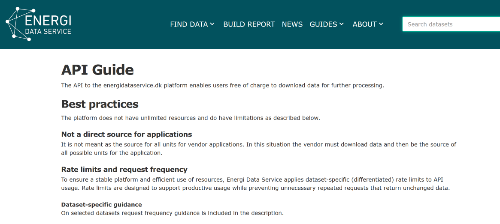

# EDS API Automation Framework

[](https://magdau.github.io/eds-python-api-test-automation/)
[](https://github.com/magdaU/eds-python-api-test-automation/actions/workflows/tests.yml)

Python-based API test automation framework for the [Energi Data Service (EDS)](https://www.energidataservice.dk/) API: pytest, Pydantic, Allure, GitHub Actions, JMeter. Built as a QA Automation portfolio project demonstrating REST API testing, parameterized/positive/negative testing, response validation, and CI/CD integration.

<p align="center">
  <a href="https://magdau.github.io/eds-python-api-test-automation/">
    
  </a>
</p>

## 📊 Test Results

| What | Where |
| --- | --- |
| Allure report (latest `main` run, with Trend, Retries, Executors, Categories) | **https://magdau.github.io/eds-python-api-test-automation/** |
| Test runs on GitHub Actions (build numbers in Allure, e.g. `#95`, are these runs) | [Tests workflow](https://github.com/magdaU/eds-python-api-test-automation/actions/workflows/tests.yml) |
| Nightly live API check (catches API drift) | [Live nightly workflow](https://github.com/magdaU/eds-python-api-test-automation/actions/workflows/live-nightly.yml) |
| Code quality (ruff, mypy, coverage) | [Quality workflow](https://github.com/magdaU/eds-python-api-test-automation/actions/workflows/quality.yml) |

## 📚 Test Documentation

| Document | Content |
| --- | --- |
| [Test strategy](docs/test-strategy.md) | Objectives, scope, test levels, techniques, environments, entry/exit criteria, risks |
| [Test plan](docs/test-plan.md) | What is tested, when, by what, and when testing is done |
| [Test cases](docs/test-cases.md) | Catalogue of all test cases (generated from the tests) |
| [Test coverage](docs/test-coverage.md) | Code coverage, mutation checks, functional coverage, known gaps |
| [Test results](docs/test-results.md) | Results of the latest CI run on `main` (generated from the Allure report) |
| [Test report](docs/test-report.md) | Summary, defects found and resolved, residual risks, recommendation |

Regenerate the generated ones with `python scripts/generate_test_cases.py` and `python scripts/generate_test_results.py`.

## 🛠️ Technologies

Python · pytest · ruff · mypy · pytest-cov · Requests · Pydantic · jsonschema · requests-mock · Docker · Allure · JMeter · Git · GitHub Actions · GitHub Pages

## 📁 Project Structure

```text
eds-python-api-test-automation/
│
├── client/
│   ├── eds_client.py    # EDSApiClient: transport, retry/backoff, per-dataset overrides, logging
│   ├── dataset_api.py   # DatasetApi: API object for one dataset (URL + get)
│   ├── news_api.py      # NewsApi: API object for /News endpoints
│   └── parsers.py       # raw JSON -> typed Pydantic models
│
├── models/               # Pydantic models (CO2EmisRecord, ElspotpricesRecord)
├── schemas/               # JSON Schema per dataset / News item, for response validation
├── allure/
│   ├── categories.json   # Allure report failure categories
│   └── report-notes.js   # explains empty Categories widgets in the generated report
│
├── tests/
│   ├── conftest.py                   # fixtures: client, API objects, parametrized dataset
│   ├── support/                      # shared test helpers: mock loading, schema asserts, dataset configs, scripted local server
│   ├── mocks/                        # requests-mock fixture data
│   ├── test_dataset_contract.py      # CO2Emis + Elspotprices: sample vs schema, request URL/parameters, real HTTP round-trip
│   ├── test_news_api.py              # News API: endpoint paths, parameters, sample vs schema (mocked)
│   ├── test_live_smoke.py            # bounded live smoke tests against the real API
│   ├── test_eds_client.py            # default/custom retry and timeout configuration
│   ├── test_pagination.py            # consecutive pages advance the offset by the limit
│   ├── test_boundary_values.py       # limit/offset boundary values
│   ├── test_parameter_combinations.py # decision table of parameter combinations
│   ├── test_filter_encoding.py       # filter encoding (non-ASCII, quotes, lists)
│   ├── test_url_building.py          # URL building and slash normalization
│   ├── test_properties.py            # property-based tests (hypothesis)
│   ├── test_retry_behavior.py        # real retry behavior against a local scripted server
│   ├── test_live_edge_cases.py       # low-load live edge cases
│   ├── test_allure_environment.py    # Allure environment.properties
│   ├── test_negative_scenarios.py    # connection timeout, connection refused
│   ├── test_schema_validation.py     # JSON Schema validation
│   ├── test_models.py                # Pydantic parsing
│   ├── test_logging.py               # warning logged when retries are exhausted
│   ├── test_support_paths.py         # fixtures load regardless of the working directory
│   └── test_retry_config.py          # per-dataset retry/backoff/jitter tuning
│
├── .github/workflows/
│   ├── tests.yml         # CI: tests, Allure report, GitHub Pages publish
│   ├── quality.yml       # CI: ruff, mypy, offline tests with coverage gate
│   ├── live-nightly.yml  # CI: nightly live tests to catch API drift (also manual)
│   └── performance.yml   # CI: JMeter run (manual / weekly)
├── performance/
│   ├── eds_api_load_test.jmx   # JMeter plan (low-load baseline)
│   └── endpoints.csv           # endpoints the plan iterates over
│
├── docs/                  # test documentation (strategy, plan, cases, coverage, results, report) + README images
├── scripts/               # generators for docs/test-cases.md and docs/test-results.md, report note injector
│
├── Dockerfile
├── requirements.txt
├── requirements-dev.txt   # ruff, mypy, pytest-cov, type stubs
├── pyproject.toml         # ruff, mypy and coverage configuration
├── pytest.ini
├── README.md
├── ROADMAP.md
├── LICENSE
└── .gitignore
```

## 🧪 Current Test Coverage

156 tests across the `CO2Emis` and `Elspotprices` datasets and the `News` API, mostly mocked (`requests-mock`)
with a handful of bounded live smoke tests against the real API:

* HTTP status code, JSON content-type, response structure
* `limit`, `filter`, `offset` (pagination), `sort` parameters
* Negative scenarios: connection timeout and refused connection; 4xx not retried (real local server);
  invalid dataset and unknown path against the live API
* News API (`/News`, `/News/actual`, `/News/calendar`, `/News/archived`): endpoint paths, parameters
  sent with their exact case, samples vs. schema; live checks of required/invalid parameters (400),
  empty results (204), unknown path (404), and calendar vs. archive consistency
* JSON Schema validation of API responses
* Pydantic model parsing (valid + invalid data)
* Boundary values (`limit`/`offset`: 0, 1, large, negative), parameter combinations (decision table),
  filter encoding (non-ASCII, quotes, lists) and URL building
* Real retry behavior against a local scripted HTTP server (503/429 then 200, retry exhaustion,
  no retry on 4xx), plus a request timeout on every call
* Low-load live edge cases (one `limit=1` request each): negative offset, unknown sort/filter column,
  filter or offset matching nothing, unknown News category/path
* Property-based tests (`hypothesis`): filter JSON round-trip, parameters surviving the URL, negative `limit`, URL building, record parsing
* Client diagnostics (against a real local server): one log line per request with status, duration and the start of an
  error body, the wait before each retry and why (`Retry-After` or backoff), and a warning when retries are exhausted;
  Allure attaches this log to each test
* Retry/backoff configuration, including per-dataset overrides and jitter
* Automatic pytest-level rerun (`pytest-rerunfailures`) on the live smoke and edge-case tests
  (network errors only), feeding Allure's Retries trend

## 🚀 Getting Started

```bash
git clone https://github.com/magdaU/eds-python-api-test-automation.git && cd eds-python-api-test-automation
python -m venv .venv
.venv\Scripts\activate      # Windows; use `source .venv/bin/activate` on macOS/Linux
pip install -r requirements.txt
pytest -v
```

Tests that hit the real EDS API carry the `live` marker. Skip them for a fast, offline run:

```bash
pytest -v -m "not live"
```

On GitHub, pull requests run only the offline tests; the full suite (including live) runs on `main`.
A nightly workflow (`live-nightly.yml`, also runnable manually) runs only the live tests to catch API drift.

Code quality (same checks as the `Quality` workflow; install dev tools with `pip install -r requirements-dev.txt`):

```bash
ruff check .                         # lint, import order, bug patterns, complexity
mypy                                 # type check (client, models)
pytest -m "not live" --cov           # offline tests; fails under 90% coverage
```

For an Allure HTML report:

```bash
pytest --alluredir=allure-results
allure serve allure-results
```

The live report is published on every push to `main` (see [Test Results](#-test-results)).

The Environment widget (base URL, Python/OS, library versions, CI branch/commit/run) is written automatically
by a pytest hook whenever `--alluredir` is used, locally and in CI.

An ad hoc local `allure serve` run only shows that single run — it won't have the
trend/executor/categories data unless you copy it in yourself.

The **Categories** widget groups only failed, broken and skipped tests (see `allure/categories.json`), so
an empty widget ("0 items total") means the run had no failures, not that categories are missing. In the published
report the widget, the **Categories** page and **Categories trend** say so themselves (`allure/report-notes.js`, added after the report is
generated; it writes the note only when the report's own data confirms there is nothing to categorize), and the
Environment widget repeats it in its `Categories` line.

### Performance tests (JMeter)

A low-load JMeter plan lives in `performance/` (requires JMeter 5.6+). Run it from that directory:

```bash
jmeter -n -t eds_api_load_test.jmx -l results.jtl -e -o report
```

Override defaults with `-Jthreads=2 -Jduration=30 -Jthinktime=1000 -Jmax_response_ms=2000`.
It hits the public EDS API, so keep the load low. In CI it runs only manually or weekly
(`performance.yml`) and uploads the HTML report as an artifact.

<p align="center">
  
</p>

### Run in Docker

```bash
docker build -t eds-api-tests .
docker run --rm eds-api-tests
```

**CI guard against empty reports.** The `Tests` workflow runs `pytest --collect-only` first and publishes the Allure
report only when pytest exits with `0` (all passed) or `1` (some failed) and `allure-results` is not empty. On any other
outcome (collection error, no tests collected) it skips the report and the `gh-pages` publish, annotates the run with
`::error::` and fails the job. It exists because a missing dependency once made collection fail, and the resulting
0-test report dropped the Allure Trend history to zero.

<details>
<summary>One-time GitHub Pages setup (only needed once, when forking/recreating this repo)</summary>

The workflow publishes the generated report to the `gh-pages` branch via
`peaceiris/actions-gh-pages`, but GitHub won't serve it until two manual,
one-time steps are done — no workflow step can do these for you:

1. The repository must be **public** (Pages hosting for a private repo needs a
   paid GitHub plan, and would default to a private site anyway).
2. Push to `main` at least once so the workflow creates the `gh-pages` branch,
   **then** go to `Settings → Pages → Build and deployment → Source` and switch
   it to **"Deploy from a branch"**, branch `gh-pages`, folder `/ (root)`. It
   can't be set before the branch exists — the dropdown has nothing to point at.

After that one-time setup, every push to `main` updates the live report
automatically.
</details>

## 🔌 API Under Test

[Energi Data Service](https://www.energidataservice.dk/) — public API, see [API docs](https://www.energidataservice.dk/guides/api-guides).

<p align="center">
  <a href="https://www.energidataservice.dk/guides/api-guides">
    
  </a>
</p>

## ✅ Completed Improvements

* [x] API client abstraction
* [x] pytest fixtures
* [x] Parameterized tests
* [x] Additional EDS datasets
* [x] API client retry with exponential backoff
* [x] GitHub Actions CI pipeline
* [x] Pagination testing
* [x] Sorting validation
* [x] Negative test scenarios
* [x] Schema validation
* [x] Pydantic models
* [x] Logging
* [x] Allure reporting
* [x] Docker support
* [x] Configurable retry/backoff tuning (jitter, per-dataset limits)
* [x] Allure trend, executors and categories widgets
* [x] Allure Retries trend
* [x] News API endpoint tests (`/News`, `/actual`, `/calendar`, `/archived`)
* [x] JMeter performance tests
* [x] CI guard against empty or broken Allure reports

All planned items are done. See [ROADMAP.md](ROADMAP.md) for the step-by-step plan behind each one.

## 👩‍💻 About the Project

A solo QA Automation portfolio project, built incrementally with a focus on clean test design and realistic QA practices.
